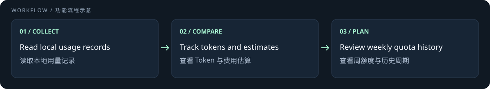

# TokenLedger OMP

**A Windows AI usage dashboard with Oh My Pi / Codex usage merging, token tracking, and weekly quota estimates.**

集中查看 AI 用量、费用估算，以及 OMP / Codex 同账号的周额度估算。

[快速安装](#下载与安装) · [English setup](#download-and-install) · [Download / 下载](https://github.com/vavilonska/tokenledger-omp/releases/latest) · [MIT](LICENSE)



> Independent OpenQuota fork. Estimates are not official balances. / 独立分支；估算不等于官方余额。

[中文](#中文) · [English](#english)

## 中文

基于 [OpenQuota](https://github.com/deviffyy/OpenQuota) 的独立桌面用量面板。集中查看 AI 编程工具的额度、重置时间、Token 用量和费用估算。公开版保留 **Oh My Pi 与 Codex 同账号用量合并、Codex 周额度估算和重置周期历史**，不包含私有业务适配器。

**0.5.8 补丁（待发布）**：OMP 的稀疏 `orchestration` object 沿既有桶规则处理：缺省 input／cacheRead 为 0，合法的仅 input/output、仅 output 或空 object 不再让缓存率误变未知；显式非法桶及顶层缺桶仍未知。parser 5→6 使有源日志重扫，持久账本版本不变；输出不计分母，编排用量不重复合计。此修复与旧 snapshot 暂无新字段的显示状态分开，不改变主题、其他提供商或自动刷新策略。

**0.5.7 功能说明（已发布）**：今天／昨天／最近 30 天的用量悬浮明细新增 **Cache rate（缓存命中率）**，展示周期汇总、模型及已有来源分行。按 `Σ缓存读取 tokens / Σ全部 prompt tokens` 加权，输出 tokens 不计分母；OMP cacheWrite 已含 1 小时桶，编排用量只计一次。缺桶、历史缺字段或零分母显示“未知”，已知零缓存且有输入显示 `0%`；与价格／速度完整性独立。保留现有 Token 纳入规则、Other 折叠及公开版隐私边界，不采集对话正文。当前版本验证／安装状态仍以发布记录为准。

**Cursor／Grok 凭据续期边界**：仅 Cursor 的本地 SQLite 凭据会自动续期，写回前会核对仍是同一份登录；刷新期间切换账号或退出登录不会被旧结果覆盖。Cursor 系统钥匙串凭据与 Grok CLI JSON 保持只读，由原客户端维护；有效 Token 继续查询，过期或失效时请在原客户端重新登录。

### 下载与安装

从 [Releases](https://github.com/vavilonska/tokenledger-omp/releases) 下载 Windows x64 安装程序，安装后从托盘打开 **TokenLedger OMP**。本次提供 Windows 安装包；其他平台保留源代码支持，但未发布或验证对应安装包。

- 独立应用标识：`io.github.vavilonska.tokenledgeromp`。
- Windows 数据：`%APPDATA%\io.github.vavilonska.tokenledgeromp`；数据库：`tokenledger-omp.db`。
- 凭据服务：`io.github.vavilonska.tokenledgeromp.api-key`；应用凭据配置路径：`~/.config/tokenledger-omp`。
- 日志：`%LOCALAPPDATA%\TokenLedger OMP\logs\TokenLedger OMP.log`。

不会迁移或共用其他 TokenLedger/OpenQuota 安装的数据、缓存、API Key 存储或自动启动标识。首次启动使用独立设置；仍可读取同机 Codex、OMP 等工具自身的登录和会话记录。高级 `OPENQUOTA_*` 环境变量名称继续兼容。

### OMP 与 Codex

- 读取 OMP 会话 JSONL，通过同一 Codex OAuth 账号校验后合并用量；账号不匹配时跳过。明细保留 **Oh My Pi** 来源。
- 保留 5 小时／周周期用量、服务端观察到的重置时间、历史周周期，以及折叠模型的来源明细。
- 在独立 SQLite 的 `local_usage_events` 薄账本中留存已采集用量；归档、移动、截断或删除对话后不再丢失，重复扫描不重复计数。不保存对话正文或凭据，展示时间窗口保持不变。
- **API USD** 与 **Codex credits** 使用独立估算和缓存，不能视为同一账单。
- 周额度金额仅在计价完整时根据本地用量和服务端额度占比估算。除下述 memory 排除项外，未知模型或请求速度会保留 tokens、将已知金额标为 **partial**，不据此推算完整额度；估算不是官方余额或实际扣费。
- 仅明确 `model_usage` 且 `purpose: "memory"` 的调用排除估算费用贡献，API USD／Codex credits 及日、会话、周和历史周期统一适用；保留 tokens、请求数和原始成本／速度证据。显示为零贡献不代表上游免费。同模型普通请求、title／cache-warm 等其他用途仍按原规则计价，缺失用途不猜为 memory。
- 保留其他提供商、托盘／浮动窗口、主题、用量历史和设置功能。详见 [Codex 提供商文档](docs/providers/codex.md)。

首次更新后请先完成一次完整刷新，再删除希望保留统计的日志。未被采集且没有可恢复解析缓存的历史无法还原；账本保留首次观察时的账号归属，不事后猜测旧日志所属账号。

旧账本仅有 Fast 布尔值时不足以证明 OMP 历史请求速度。有源日志会重新解析；已留存请求证据可用于重算，但源已删除且证据不足时只能保留 tokens 和未知费用，不能还原完整金额。保留了明确 memory 用途的历史在成功刷新后排除估算贡献，不丢失 tokens、请求数或原周期覆盖；缺失用途的历史不推断为 memory。历史周期边界和首次观察账号归属保持不变。

### 开发与验证

需要 Node.js 22+、pnpm 11.11.0、稳定版 Rust 和 [Tauri 2 开发依赖](https://v2.tauri.app/start/prerequisites/)。Windows 安装包采用 Rust GNU target 与 MinGW 工具链。

```powershell
git clone https://github.com/vavilonska/tokenledger-omp.git
cd tokenledger-omp
corepack pnpm install --frozen-lockfile
corepack pnpm tauri dev
# 检查 / checks
corepack pnpm verify:contracts
corepack pnpm check
corepack pnpm test
cargo test --manifest-path src-tauri/Cargo.toml --lib --locked
# Windows 安装包 / installer
corepack pnpm build:installer
```

### 上游与发布边界

**0.5.6** 在主 Codex 账号周剩余额度大于 0%、不超过 3% 时，将刷新间隔从 300 秒缩短为 15 秒；归零后恢复普通频率，新周重新跟踪。首次观察周额度归零后，同周期后续 Token 消费按额外额度处理，其费用不计入订阅周期消费和额度外推，总消费账本仍保留 Token、请求和费用证据；不新增 UI 标记。既有价格和明确 memory 用途排除规则不变。刷新倒计时按后端精确 deadline 逐秒更新。

本版还在现有周期历史浮层加入上下两张共享周期横轴的图：上图显示服务器观察到的额度消耗百分比，下图显示周期完整 Token 用量；支持历史范围导航，保留明细、中文和主题，未知值不补零。复用现有桌面界面，不增加独立 WebUI 服务、服务器或依赖。

当前已发布 Windows x64 NSIS 包见 [v0.5.7](https://github.com/vavilonska/tokenledger-omp/releases/tag/v0.5.7)：`TokenLedger-OMP_0.5.7_x64-setup.exe`，10,450,026 bytes，SHA-256 为 `922c1d03dc7e28edb2a1209972c8494d8b744945c8440990602d096a923151a8`，附 `.sha256`。0.5.8 补丁准备不覆盖该版本 tag 或资产。公开版未安装或验证原生 UI，完整范围与首次失败／定向修复见[发布记录](docs/releasing.md)。

**0.5.5** 区分 Standard、Fast、Ultrafast；GPT-6 Astra 与 GPT-6.1 Sol 的 Ultrafast 按 API／购买积分 6× 计价，不采用套餐额度消耗倍率。OMP 辅助调用不再直接继承主会话速度，缺失或冲突证据保持未知。总计、模型、周期和分享明确标记部分估算；Cost/MTok 只纳入完整计价提供商，并说明覆盖范围，无可用费用时仍显示 tokens。

**0.5.4** 更新价格目录并纳入 GPT-6.1 Sol（每百万 tokens：输入 $2、缓存读取 $0.10、缓存写入 $2.50、输出 $10），支持 Fast 与长上下文计价。Codex credits 按购买积分／PAYG 费率独立估算，不代表套餐内额度消耗。新增本地用量薄账本，覆盖 Codex、OMP、Claude、pi、Grok 和 OpenCode 的已采集用量。

0.5.3 修复 Windows 测试构建：正式程序与测试程序共用 Common Controls 6 清单，解决库测试启动时找不到 `TaskDialogIndirect` 的 `0xc0000139` 错误。无需手动修改测试 EXE。OMP 与 Codex 用量逻辑保持不变。

2026-09-22 核对 OpenQuota `main` 为 [`0b21b35`](https://github.com/deviffyy/OpenQuota/commit/0b21b354e1a0)，当前基线已包含它。近期依赖升级、多账号和命令行功能仍是未合并 PR，没有当作稳定修复直接引入。见 [上游核对记录](docs/upstream-review.md)。

目前通过 Releases 手动更新；签名更新源未配置，应用检查更新会返回 `not_configured`。Windows 文件未做 Authenticode 签名。验证范围以 Release 说明为准，见 [发布说明](docs/releasing.md)。

代码采用 [MIT](LICENSE)，保留 OpenQuota 原作者版权。本项目是独立分支，与 OpenQuota、OpenAI 或 Oh My Pi 官方无隶属关系。欢迎 [Issue 和 PR](https://github.com/vavilonska/tokenledger-omp)。

## English

An independent desktop usage dashboard based on [OpenQuota](https://github.com/deviffyy/OpenQuota), showing AI coding quotas, resets, tokens and estimated costs. This public edition preserves **same-account Oh My Pi/Codex usage merging, Codex weekly quota estimates and reset-cycle history**, without private business adapters.

**0.5.8 patch (unreleased):** Sparse OMP `orchestration` objects now reuse the existing bucket contract: omitted input/cacheRead are zero; input/output-only, output-only and empty objects no longer make cache rates unknown. Explicit invalid buckets and missing top-level buckets remain unknown. Parser 5→6 reparses available sources without changing the durable ledger schema, including output in the denominator, or double-counting orchestration. This is separate from older snapshots lacking new fields; themes, other providers and automatic refresh policies are unchanged.

**0.5.7 feature notes (released):** Today / Yesterday / Last 30 Days usage popups show **Cache rate** for the period, each model and existing source/variant rows. Rates use `sum(cache-read tokens) / sum(all prompt tokens)`, never an average of percentages or an output-token denominator. OMP cache writes already include the one-hour bucket, and orchestration is counted once. Missing buckets, legacy fields or a zero denominator remain unknown; known zero cached input with positive prompt tokens shows `0%`. Cache completeness is independent of pricing/speed completeness. Existing token inclusion, Other folding and public-edition privacy boundaries remain unchanged; no conversation text is collected. Validation and installation status remain documented in the release record.

**Cursor/Grok credential renewal:** Only local Cursor SQLite credentials are automatically renewed, with a conditional write that preserves account switches and logout during refresh. Cursor system-keychain credentials and Grok CLI JSON remain read-only and are maintained by their original clients. Valid tokens continue to be queried; expired or rejected credentials require signing in again through the original client.

### Download and install

Download the Windows x64 installer from [Releases](https://github.com/vavilonska/tokenledger-omp/releases), then open **TokenLedger OMP** from the tray. This release provides a Windows installer; source support for other platforms remains, but their packages have not been released or validated here.

- Independent application ID: `io.github.vavilonska.tokenledgeromp`.
- Windows data: `%APPDATA%\io.github.vavilonska.tokenledgeromp`; database: `tokenledger-omp.db`.
- Separate credential service: `io.github.vavilonska.tokenledgeromp.api-key`; app credential configuration: `~/.config/tokenledger-omp`.
- Logs: `%LOCALAPPDATA%\TokenLedger OMP\logs\TokenLedger OMP.log`.

It does not migrate or share other TokenLedger/OpenQuota installations' data, caches, API-key storage or autostart identity. It starts with independent settings, while reading the local Codex/OMP clients' own authentication and session records. Advanced `OPENQUOTA_*` environment names remain compatible.

### OMP and Codex

- Reads OMP session JSONL and merges usage only after matching the Codex OAuth account. Mismatched accounts are skipped; breakdowns retain **Oh My Pi** source labels.
- Preserves five-hour/weekly usage, server-observed reset times, historical weekly cycles and source labels inside folded model groups.
- Retains observed usage in the independent SQLite `local_usage_events` ledger. Archiving, moving, truncating or deleting conversations does not erase collected usage, and repeat scans do not double-count it. Conversation text and credentials are not stored; rolling display windows are unchanged.
- **API USD** and **Codex credits** have separate estimates and caches; they are not interchangeable bills.
- Weekly monetary capacity is estimated only from complete local estimates and the server quota percentage. Except for the explicit memory exclusion below, unknown models or request speeds retain tokens and mark known-cost subtotals **partial**, without inferring a full allowance. Estimates are not official balances or actual charges.
- Only explicit `model_usage` calls with `purpose: "memory"` are excluded from estimated cost contributions, in API USD and Codex credits across daily, session, weekly and historical cycles. Tokens, requests and original cost/speed evidence are retained; a zero contribution does not mean the upstream call was free. Ordinary requests on the same model and other purposes such as title/cache-warm keep their normal pricing rules; missing purposes are never guessed to be memory.
- Retains other providers, tray/floating modes, themes, history and settings. See the [Codex provider guide](docs/providers/codex.md).

Complete a full refresh after updating before deleting logs you want to retain. Unobserved history without a recoverable parsed cache cannot be restored; retained events keep their first-observed account scope rather than guessing old logs' ownership.

After a successful refresh, retained historical facts with explicit memory purpose are re-estimated under this exclusion even if the source log was deleted, without losing tokens, requests or original cycle coverage. Historical facts missing that purpose keep the previous pricing/partial rules; cycle boundaries and first-observed account ownership are unchanged.

### Development and validation

Requires Node.js 22+, pnpm 11.11.0, stable Rust and [Tauri 2 prerequisites](https://v2.tauri.app/start/prerequisites/). Windows builds use the Rust GNU target and MinGW. Use the clone, development, check and installer commands above.

### Upstream and release boundaries

**0.5.6** shortens the primary Codex account's refresh interval from 300 to 15 seconds while weekly remaining quota is above 0% and at most 3%. Ordinary frequency resumes at zero; a new week restores quota tracking. After the first observed weekly zero, later consumption in that cycle is treated as extra allowance: its cost is excluded from subscription-cycle spend and allowance extrapolation, while the total ledger retains tokens, requests and cost evidence. No new UI badge is added. Existing pricing and explicit memory-purpose exclusions are unchanged. The countdown updates every second from the backend's precise deadline.

The existing cycle-history popup also gains two stacked charts sharing the cycle axis: server-observed quota-used percentage above and complete cycle tokens below. Historical range navigation preserves details, Chinese labels and themes; unknown values remain gaps rather than zero. This uses the existing desktop UI, without a separate WebUI service, server or dependency.

The current published [v0.5.7 Windows x64 NSIS package](https://github.com/vavilonska/tokenledger-omp/releases/tag/v0.5.7), `TokenLedger-OMP_0.5.7_x64-setup.exe`, is 10,450,026 bytes with SHA-256 `922c1d03dc7e28edb2a1209972c8494d8b744945c8440990602d096a923151a8` and an adjacent `.sha256`. Preparing 0.5.8 does not replace that tag or its assets. This public edition was not installed or exercised in the native host; see the [release record](docs/releasing.md) for scope, original failures and targeted repairs.

**0.5.4** refreshes price catalogs and adds GPT-6.1 Sol (USD per million tokens: input $2, cached input $0.10, cache writes $2.50, output $10), including Fast and long-context pricing. Codex credits independently estimate purchased-credit/PAYG rates, not included plan-limit consumption. A compact local ledger retains observed Codex, OMP, Claude, pi, Grok and OpenCode usage.

0.5.3 fixes Windows test builds: application and test executables share a Common Controls 6 manifest, resolving the library-test startup error `0xc0000139` caused by an unavailable `TaskDialogIndirect`. Test executables no longer need manual patching. OMP and Codex usage logic is unchanged.

On 2026-09-22, OpenQuota `main` was [`0b21b35`](https://github.com/deviffyy/OpenQuota/commit/0b21b354e1a0), already in this source baseline. Recent dependency updates, multi-account support and CLI changes are unmerged PRs, not imported as stable fixes. See the [upstream review](docs/upstream-review.md).

Update manually through Releases. A signed in-app feed is unconfigured; checks return `not_configured`. Windows binaries are not Authenticode-signed. See each release for its actual validation scope and [release documentation](docs/releasing.md).

[MIT](LICENSE), retaining the OpenQuota copyright. This is an independent fork, not an official OpenQuota, OpenAI or Oh My Pi product. [Issues and pull requests](https://github.com/vavilonska/tokenledger-omp) are welcome.

## Related projects / 相关项目

[OMPmail](https://github.com/vavilonska/OMPmail) · [OMP Pet](https://github.com/vavilonska/omp-pet) · [All projects / 全部项目](https://github.com/vavilonska?tab=repositories)
